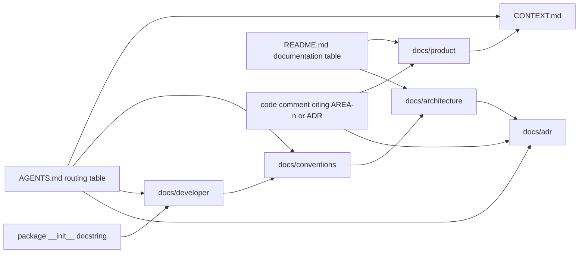

# Repository documentation system

## Overview

Every fact has one home, every document says what it holds and where its neighbours are, and code points to the guide that explains it. Agents read by following pointers: a fact nothing points to is a rule nobody follows, and a fact written twice is two rules that drift apart.

The repository is self-sufficient. This skill helps write the documents; once written, they hold every project rule, so a person or an agent without this skill still finds them.

## When to use

- Finishing any code change, before reporting it done or opening a pull request: decide which documents it moves, or confirm that none does.
- Starting a repository, or bringing order to one with no docs or a pile of them.
- Writing or trimming `AGENTS.md` / `CLAUDE.md`.
- Introducing or renaming a domain concept.
- Changing a shared module's public API, a structural decision, a dependency edge, an environment variable, or the product scope.
- Docs and code disagree, or agents ignore rules that are "written down somewhere".

Not for: coding rules of one language (for a Python backend, use `clean-python-backend`), end-user manuals, or API reference generated from code.

## The documents

| File                                 | Holds                                                                                                                          | Never holds                                               |
| ------------------------------------ | ------------------------------------------------------------------------------------------------------------------------------ | --------------------------------------------------------- |
| `README.md`                          | What the project is, quick start, deployment, a table indexing every document                                                  | Rules for contributors or agents                          |
| `AGENTS.md` (+ `CLAUDE.md` symlink)  | "Before working on X, read Y" routing table, layout, commands, done means, hard rules, gotchas                                 | Explanations: the routing table points to them            |
| `CONTRIBUTING.md`                    | Setup, checks, commit messages, pull requests, what CI runs when                                                               | How code looks (links to conventions)                     |
| `CONTEXT.md`                         | Glossary: each term, its definition, the synonyms to avoid                                                                     | How anything is built                                     |
| `docs/product/overview.md`           | Scope, personas, success criteria, product decisions                                                                           | Implementation                                            |
| `docs/product/requirements.md`       | Requirements with stable IDs (`AREA-n`) and acceptance criteria                                                                | Scope debates (the overview settles them)                 |
| `docs/architecture/overview.md`      | System context, technology, modules with status, dependency rules, runtime composition, configuration layers, data, deployment | Coding rules, rationale (ADRs)                            |
| `docs/conventions/<area>.md`         | How code in one area is organised and written, and what enforces each rule                                                     | Why (ADRs), module APIs (guides)                          |
| `docs/developer/README.md`, `<m>.md` | One guide per shared module: purpose, quick start, API, recipes, pitfalls, testing                                             | General rules, rationale, requirements                    |
| `docs/adr/NNNN-<slug>.md`            | One hard-to-reverse decision: the choice, the rejected options, the consequences                                               | Anything undecided (the architecture overview marks Open) |
| `.github/pull_request_template.md`   | What and why, how it was verified, deploy notes, a checklist of what CI cannot check                                           | Checks CI already runs                                    |

## Pointer chains



Each arrow is a sentence someone wrote on purpose. Wire all of them:

1. **Every document opens with its role and its neighbours**, in one or two sentences before the first heading:

   ```markdown
   How backend code is organised and written. The overall shape is in the [architecture overview](../architecture/overview.md);
   the reasons for the larger rules are in the [decision records](../adr/). Use the terms from [CONTEXT.md](../../CONTEXT.md).
   ```

2. **Index files say "here" and "not here".** `docs/developer/README.md` lists what its guides contain and, with links, where everything else lives.
3. **Packages point to their guide.** A shared module's `__init__.py` docstring is one paragraph saying what it is, then `Usage: docs/developer/<module>.md.` Its main service module repeats the pointer.
4. **Comments cite IDs, not stories.** A rule that looks arbitrary carries its source: `# APP-4: how long the replaced secret keeps working`, `See docs/adr/0002-utc-only-backend-time.md.` Requirement IDs and ADR numbers are stable; paraphrases are not.
5. **Configuration explains itself.** Each lint ignore, pinned version bound, and CI step has a trailing comment saying why: `# sso/ subclasses Authlib internals; re-run the SSO tests before raising the bound`.
6. **One home per fact**; everywhere else links to it. Check commands are the one deliberate copy: `AGENTS.md`, `CONTRIBUTING.md`, the `Makefile`, and CI run the identical line, and a change to one changes all four.
7. **Relative links, with anchors** when a section is meant: `[backend conventions](../conventions/backend.md#models-and-migrations)`.
8. **Never route an agent to a skill for a project rule.** If agents need a rule, it lives in the repository and `AGENTS.md` points to the file.

After restructuring, run `python <this skill>/scripts/check_links.py <repo>`: it reports relative Markdown links, heading anchors, and `docs/….md` pointers in code that resolve to nothing.

## Workflows

### New repository

1. Gather facts. Ask only what files and the conversation cannot answer: the product in one paragraph, its personas, the 5–15 nouns people use for the domain and the synonyms they also use, the stack, the check commands.
2. Copy each template from `assets/templates/` to its destination, fill every `{{placeholder}}`, and delete sections that do not apply. Never leave a placeholder or an empty section behind.
3. Write `CONTEXT.md` before code names any concept (`references/glossary.md`).
4. `ln -s AGENTS.md CLAUDE.md`.
5. Run `scripts/check_links.py`.

| Template                          | Destination                        |
| --------------------------------- | ---------------------------------- |
| `AGENTS.template.md`              | `AGENTS.md`                        |
| `README.template.md`              | `README.md`                        |
| `CONTRIBUTING.template.md`        | `CONTRIBUTING.md`                  |
| `CONTEXT.template.md`             | `CONTEXT.md`                       |
| `docs/…`                          | The same path                      |
| `github/pull_request_template.md` | `.github/pull_request_template.md` |

Root-level templates carry `.template` so tools do not load them as the skill's own `AGENTS.md` or `README.md`. Conventions for a language come from that language's skill: for a Python backend, `clean-python-backend` supplies `docs/conventions/backend.md`.

### After every code change: align the docs

Every change ends with this check, in the same change as the code; a documentation follow-up never comes. Most changes move no document, and the check says so explicitly instead of skipping the question.

1. **List what the change touched**, from the diff: names (domain terms, public functions and classes, routes, error codes, signals, CLI commands), modules added, moved, or removed, settings and environment variables, migrations, dependencies, and behaviour a user or a caller can observe.
2. **Find every document that states those facts.** Follow the pointer of each touched package (`__init__.py` docstring → its guide), and search the docs for each changed or removed name, old names included:

   ```bash
   rg -n -w '<name>|<old_name>' docs AGENTS.md README.md CONTRIBUTING.md CONTEXT.md
   ```

3. **Walk the table below** for what is new: a new fact needs a home even when no existing sentence became wrong.
4. **Update each document whose statement is no longer true**, and add the new facts where the table says.
5. **Record the outcome** in the pull request (or the final report): the documents updated, or `Docs: none needed`, with the reason (an internal refactor with no change to names, behaviour, structure, or configuration).
6. **Run `scripts/check_links.py`** when a document, heading, or module was added, renamed, or removed.

| Change                                                | Update                                                                                           |
| ----------------------------------------------------- | ------------------------------------------------------------------------------------------------ |
| New or renamed domain concept                         | `CONTEXT.md` first, then the code                                                                |
| Something renamed or removed                          | Every mention of the old name, found by search; delete statements about what no longer exists    |
| Shared module's public API                            | Its guide in `docs/developer/`; for a new module also the index and the `__init__.py` pointer    |
| Behaviour a user or caller can observe                | The guide that describes it; `docs/product/requirements.md` if a requirement or its values moved |
| New module, dependency edge, extension point, or flow | `docs/architecture/overview.md`, with its status marker                                          |
| Hard-to-reverse decision                              | A new ADR (`references/adr.md`)                                                                  |
| New coding rule                                       | `docs/conventions/<area>.md`; if a tool can check it, configure the tool too                     |
| Something found to fail silently                      | The guide's Pitfalls, or `AGENTS.md` Gotchas when it crosses modules                             |
| New environment variable                              | Every `.env.example`, the architecture configuration table, the pull request's deploy notes      |
| New or changed command                                | `AGENTS.md`, `CONTRIBUTING.md`, the `Makefile`, and CI, identically                              |
| Scope change                                          | `docs/product/overview.md`                                                                       |
| New document                                          | `README.md` documentation table; the `AGENTS.md` routing table if agents need it before a change |

The repository carries its own copy of this check (`CONTRIBUTING.md`, "Which docs a change moves", from the template), and `AGENTS.md` "Done means" points to it, so agents without this skill run it too.

### Docs and code disagree

Ask which one is right before changing either. Fix the wrong one, and if the gap stayed silent, add the pitfall or gotcha that would have caught it.

## Writing

- English, present tense, short sentences, one fact each. No marketing and no history ("we used to…"): history lives in git and in ADR revisions.
- Use `CONTEXT.md` terms exactly, never their `_Avoid_` synonyms.
- Status markers instead of hedging: **Implemented**, **Planned**, **Open** in the architecture overview; `Status: accepted (date)` on an ADR; `Status: draft for review, date` on product documents.
- Files, symbols, commands, and environment variables in backticks, so a reader can grep them.
- Tables for parallel facts, numbered lists for order, mermaid only for real structure.

## Common mistakes

| Mistake                                    | Fix                                                                                                     |
| ------------------------------------------ | ------------------------------------------------------------------------------------------------------- |
| `AGENTS.md` grows into a manual            | Keep it near 100 lines; move each explanation into the document the routing table points to             |
| A rule in both `AGENTS.md` and conventions | Keep it in conventions; `AGENTS.md` keeps only rules whose breach is silent and costly                  |
| A guide without Pitfalls                   | Ask "what goes wrong without an error?": that section is why guides exist                               |
| An ADR for every choice                    | Only for decisions that are hard to reverse, surprising without context, and a real trade-off           |
| The pull request checklist repeats CI      | List only what CI cannot check                                                                          |
| Glossary entries without `_Avoid_`         | The avoided synonyms are what keeps names from drifting                                                 |
| A module without a pointer to its guide    | Agents reading the code never find the guide; add `Usage: docs/developer/<module>.md.` to `__init__.py` |
| Docs updated in a later pull request       | Same change, or the reviewer sends it back                                                              |
| Code changed, docs never checked           | End every change with the alignment check; "none needed" is an answer, silence is not                   |

## References

- `references/agents-md.md`: anatomy and budget of `AGENTS.md`; routing rows; hard rules versus gotchas.
- `references/glossary.md`: writing and policing `CONTEXT.md`.
- `references/product-and-architecture.md`: the product overview, requirements with IDs, and the architecture overview.
- `references/developer-guides.md`: shared-module guides and conventions documents.
- `references/adr.md`: when and how to record a decision, revise it, or supersede it.
