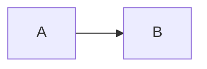

# Demo · Plan

- Status: aligned
- Date: 2026-11-10

## At a Glance

- Use the standard library.

## 背景

A small demonstration.

## 决策

### ADR-1: Use Node

- Status: accepted
- Context: Existing runtime.
- Decision: Use Node.
- Consequences: No dependencies.
- Rejected: Another runtime.

### ADR-2: Alternative

- Status: superseded by ADR-1
- Context: A prior option.
- Decision: Superseded.
- Consequences: One runtime.

## 架构

## 未决问题

- [x] Runtime? — Node.
